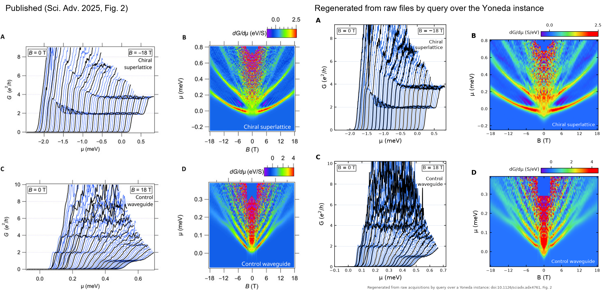

# Fig. 2 of Briggeman et al. (2025), regenerated through Yoneda

Briggeman et al., "Engineered chirality of one-dimensional nanowires," *Science Advances* 11, eadx4761 (2025), doi:10.1126/sciadv.adx4761. Fig. 2 shows conductance and transconductance of a chiral superlattice (device A) and its control waveguide at 25 mK, 0 to 18 T.

This example regenerates that figure from the raw acquisition files the lab wrote in 2017, through a Yoneda instance built on the Yoneda genome (`yoneda/cell/cell.sql` at the repository root, a submodule pinned to commit bbe0d62). The Harvard Dataverse deposit that accompanies the paper (doi:10.7910/DVN/J37IY0) is not read by any step that produces the figure. It is read once, by `verify.py`, to compare.

## Read it

    marimo edit report.py

`report.py` is a marimo notebook. It opens the instance shipped in `instance/`, redraws the figure from it and checks the bytes against the figure cell, shows one acquisition as stored, the wiring correction, the gate-jump derivation, the calibration claims and the audit. If the lab's raw files are mounted (`-- --store <root>` or `LEVYLAB_DATA`), it also reruns the audit against them.

## The single place

All bytes come from one store, the lab Data tree, cooldown `MNK/SA03018F.20171127`: sample SA03018, canvas F, measured from 27 November to 16 December 2017 (headers give T = 25 mK). The figure uses run 17B (superlattice, 114 sweeps) and run 16A (control, 123 sweeps). Nothing is copied out of the store. The instance records each file by the SHA-256 of its bytes and where it was found, and every later read re-hashes the bytes against that identity.

The raw files are not in this repository. Everything needed to redraw the figure and read the notebook is: the instance (`instance/fig2.yoneda.db`, 2.7 MB) and its derived blobs (`instance/derived/`, 4.5 MB), each named by its own hash.

## Rerun

    py figure.py --db instance/fig2.yoneda.db --roots fig2-yoneda:blobs=instance/derived --out fig2.png
    py rebuild.py --out <folder> --store <lab Data root>            from raw bytes, about 25 s
    py rebuild.py --out <folder> --store <lab Data root> --all      the whole cooldown folder, every file

The first line needs only this folder and reproduces `instance/fig2_regenerated.png` byte for byte (sha256 `748312408cc81399...`). The other two need the raw files.

## The steps, each one a cell

| Script | What it writes |
|---|---|
| `ingest.py` | a `file` cell per file (id = sha256 of the bytes), a `located` cell per path, a `run` cell per acquisition with t = the file's own clock (2017) and rt = when ingested (2026), an `experiment` per folder, two `wiring` claims per experiment and a `check` of each |
| `claims.py` | the paper, the published Fig. 2 image as a file cell, `depicts` claims linking panels 2A to 2D to runs 17B and 16A, a `lever-arm` claim per device |
| `derive.py` | three `derivation` cells per device (conductance, gate-jump removal, transconductance with mirror symmetrization) and a `check` of the paper's definition of mu0, each output stored as a content-addressed blob |
| `figure.py` | the PNG as a file cell and one `derivation` cell whose 13 faces are its witnesses |
| `verify.py` | the audit, below |

`derive.py` and `figure.py` are never told which runs to use. They ask the instance which experiments the paper's active `depicts` claims name, which wiring claim is active, and which lever arm is active. Retracting a claim changes the figure without changing the code. `yo.py` imports the genome's `cell/cell.py` unmodified; the only addition is that a file cell's id is the SHA-256 of the file's bytes rather than of its JSON payload, so anyone holding the file can check it.

## What the files record, and what they do not

Regenerating a figure from raw bytes makes every step between the instrument and the page explicit, including the ones that were done by hand and never written down. These are the places where that happened here. None of them changes what the figure shows.

The wiring is written twice in every file, once in the typed lock-in table in the header and once by LabVIEW in an INDEX block. For runs 16 and 17B the INDEX block still lists the wiring of the other section of the device, which is easy to leave behind when a measurement moves between sections. Each source was checked against the conductance the instrument computed during the measurement: the typed table matches it to 0.1% in every run, and the INDEX block matches only in 16A. The two INDEX claims that do not match are retracted by `outcome` cells that point at the checks. They remain in the database, and no derivation sees them.

The typed headers of runs 17B and 16A describe each field sweep as starting at zero. The files' own clocks and field readings show both ran from 18 T toward zero. The run cells keep the header text as written and take the order from the clocks.

The published waterfall curves are the raw sweeps shifted uniformly in V_sg, by 1.50 mV for 17B and 0.75 mV for 16A, constant across field to 0.15 mV. That is the size of a lock-in lag correction at this sweep rate. The files do not record the rule, so this example plots the sweeps as recorded.

The published maps have discrete gate jumps removed, as is usual for maps assembled over hours of field sweep, and the waterfalls keep them. The rule used is not recorded, so `derive.py` applies one stated rule and stores what it found: 17B at -2.28, -1.48 and -0.83 T (5.8, 3.2, 6.7 mV), 16A at +1.76, +1.46 and +1.31 T (26.6, -4.8, 3.7 mV). The 26.6 mV jump pushes the low-field control sweeps past the top of the gate range and leaves an empty rectangle at the top of the map, and the published Fig. 2D has the same rectangle in the same place.

The paper writes mu = mu0 + alpha V_sg. The numbers are read off the published mu axes against the raw gate range, 8.13 ueV/mV for the superlattice and 3.93 ueV/mV for the control, and entered as `lever-arm` claims whose evidence is the published image.

The two alignment rules differ near zero field. With all three jumps removed and the first sweep as anchor, the superlattice onset at B = 0 sits at mu = -0.11 meV under that calibration, where the published map puts it at 0. This shows in panel B as a dip at the bottom of the V and is stored as a `check` cell.

## Audit (`instance/verify.json`)

Part 1 uses only the instance and the bytes. All 237 raw files behind the figure re-hash to their cells. Every derivation, rerun from the inputs its faces name and the parameters its data hold, produces the blob it recorded, compared by hash. The figure redrawn from the instance is byte-identical to the recorded one, including when the instance and its blob folder are moved. Two builds made from scratch produced identical derived-blob hashes.

Part 2 compares with the deposit. The transconductance maps correlate at 0.985 (chiral) and 0.892 (control) for |B| > 3 T, with amplitude ratios (published over ours) of 1.06 and 1.23. Below 3 T they diverge, where the two alignment rules differ.

## Not done

The finite-bias run 18A is ingested; deriving the lever arm from it is left for later. Fig. 3 uses the same two runs and would add one derivation (line cuts) and one render.

## Credits

The published figure in `reference/` is from Briggeman et al., *Sci. Adv.* 11, eadx4761 (2025), distributed under CC BY 4.0. The measurements are by the authors of that paper.
